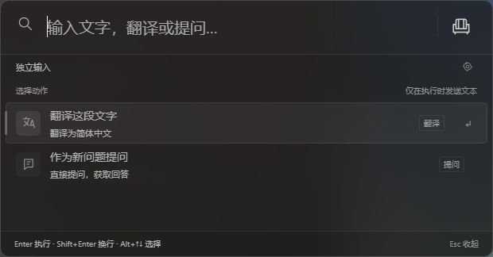
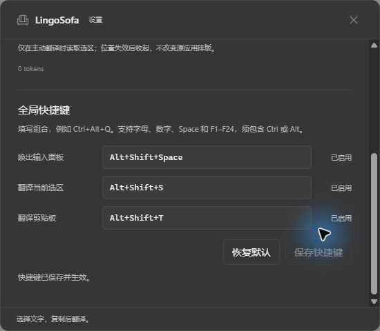

<p align="center">
  
</p>

<h1 align="center">LingoSofa</h1>

<p align="center">双语阅读，就地提问。</p>

<p align="center">
  <a href="README.md">English</a> · <a href="README-zh.md">简体中文</a>
</p>

<p align="center">
  
  
  <a href="LICENSE"></a>
</p>

LingoSofa 是 Windows 上的悬浮翻译工具。选中文字，在旁边阅读译文；遇到不明白的内容，再打开 Ask 继续提问。输入翻译和独立问题共用一个轻量面板，需要时随手唤出。

[效果预览](#效果预览) · [开始使用](#开始使用) · [文档](#文档) · [反馈问题](https://github.com/ChenMiaoi/lingo-sofa/issues)

> **开发预览版。** 当前桌面版面向 Windows 11 x64，安装包尚未签名。浏览器选区仍待人工验收；截图 OCR、更多供应商和 OAuth 尚未提供。已验证的应用范围与剩余工作见 [兼容与验收状态](docs/acceptance.md)。

## 效果预览

**翻译与提问，收进一个轻量面板。** 灰黑半透明界面，需要理解一段文字时再展开。

<p align="center">
  
</p>

<details>
<summary>展开查看全局快捷键设置</summary>

**让快捷键顺手。** 修改每项组合，查看启用状态，需要时恢复默认。

<p align="center">
  
</p>

</details>

截图来自 Windows 原生桌面应用，使用未配置模型账户的独立测试配置。

## 功能

- **翻译选中文字**：在选区旁阅读译文，原文保留在正在使用的应用中；来源位置失效后，轻量译文自动收起。
- **围绕内容提问**：保留选中的原文上下文，流式阅读回答并继续追问；可停止生成，也可手动压缩会话。
- **翻译输入或复制的内容**：打开输入面板，翻译一段文字或提出独立问题；也可主动翻译当前剪贴板文本。
- **按习惯设置快捷键**：在其他应用中唤出面板，修改三项全局组合并在重启后保留；冲突时提示，保留原设置。
- **使用自己的模型账户**：配置 DeepSeek API Key，使用 DeepSeek V4.1 Flash。凭证按当前 Windows 用户加密保存。
- **查看实际观测用量**：查看已报告的 Tokens 和用量不完整的调用；未知用量不会当成零，中断请求不会自动重发。

## 开始使用

桌面版暂未发布公开 Release，可先 [从源码构建](#开发) 生成 Windows 安装包；安装后的用户无需 Bun 或 Rust。完整设置与使用方法见 [安装说明](docs/installation.md)。

1. 启动 LingoSofa，通过边缘入口或系统托盘打开 **设置**。
2. 填写自己的 DeepSeek API Key，选择目标语言。
3. 选中文字后翻译，或打开输入面板翻译、提出独立问题。在译文中打开 **Ask**，可围绕同一段原文继续追问。

| 默认快捷键          | 操作                     |
| ------------------- | ------------------------ |
| **Alt+Shift+Space** | 唤出输入翻译或独立提问。 |
| **Alt+Shift+S**     | 翻译当前选中文字。       |
| **Alt+Shift+T**     | 翻译剪贴板文本。         |

在 **设置 → 全局快捷键** 中修改组合，保存后即时生效；注册失败时保留原设置，仍可通过边缘入口或托盘操作。

输入面板内，**Enter** 执行，**Shift+Enter** 换行，**Alt+↑↓** 切换动作，**Esc** 返回阅读。面板已打开时，再次按唤出快捷键会保留当前草稿。

选区取文能力取决于来源应用。当前已对记事本、开启可访问性的独立 VS Code 和 Discord 消息正文完成限定场景验证。浏览器选区尚未通过，可按 [手动验收步骤](docs/browser-manual-acceptance.md) 检查。

## 隐私与数据

LingoSofa 在本机运行，不要求部署专门的云端后台。主动提交的翻译、问题，以及回答和压缩所需的会话上下文，会通过你自己的账户发送给 DeepSeek。

仅在主动请求剪贴板翻译时读取其文本。原文、译文和会话只驻留内存；凭证在本机加密保存，用量账本记录调用信息，不保存消息正文或密钥。没有遥测，也不会自动重发失败请求。

用量只反映 LingoSofa 观测到的调用，不代表整个供应商账户的账单。取消请求不能保证供应商停止计费。详细边界见 [隐私说明](docs/privacy.md)。

## 开发

macOS（Apple Silicon 与 Intel）的构建方式、平台差异和验证边界见 [开发指南](docs/development.md#macos)。

运行时检查还需要 [cargo-nextest](https://nexte.st/docs/installation/pre-built-binaries/) 0.9.149。CI 安装固定版本的预编译工具；本机可从 crates.io 安装：`cargo install cargo-nextest --version 0.9.149 --locked`。

Windows x64 开发环境需要 **Bun 1.3.14**、**Node.js 24**、**Rust 1.98.1 MSVC**、Visual Studio C++ Build Tools 和 WebView2。在项目目录运行：

```powershell
bun install --frozen-lockfile
npm run dev
```

开发入口会构建内部 worker 和选区取文助手，再启动前端与桌面应用。

| 命令                            | 用途                                           |
| ------------------------------- | ---------------------------------------------- |
| `npm run dev`                   | 启动桌面开发环境。                             |
| `npm run check`                 | 检查 lint、格式、类型、回归、Rust 与应用构建。 |
| `npm run test:runtime:packaged` | 使用独立打包 worker 验证 Rust 运行时。         |
| `npm run test:sdk`              | 运行隔离的 SDK 探针。                          |
| `npm run build`                 | 生成 Windows NSIS 安装包。                     |

正式安装包输出到 `target/release/bundle/nsis`。开发安装包使用 `bun scripts/desktop.ts build --debug`，输出到 `target/debug/bundle/nsis`。

常规检查使用本机模拟服务。显式运行 `verify:live` 或 `verify:live:dual` 会从被忽略的本机 `.env` 读取 `API_KEY`，产生真实供应商用量；它们使用隔离配置，不会设置日常桌面账户。

### 仓库结构

```text
apps/
  desktop/       React 界面与 Tauri Windows 应用
  omp-worker/    内嵌的 oh-my-pi 模型与会话 worker
crates/          Rust 应用服务、调度与系统适配
tests/           界面、SDK 与进程集成回归
docs/            产品设计、使用说明与开发指南
```

## 文档

| 文档                                 | 内容                         |
| ------------------------------------ | ---------------------------- |
| [安装说明](docs/installation.md)     | 设置、日常使用与快捷键配置。 |
| [隐私说明](docs/privacy.md)          | 内容边界、凭证与数据保留。   |
| [架构与协议](docs/architecture.md)   | 桌面模块、进程与存储。       |
| [兼容与验收状态](docs/acceptance.md) | 已验证的流程与剩余验收。     |
| [技术方案](docs/lingo-sofa-plan.md)  | 产品方向与后续能力规划。     |

开发命令、CI 报告与平台说明见 [开发指南](docs/development.md)。

## 参与贡献

欢迎提交问题、可复现示例和聚焦的改进。较大的变更请先通过 [Issue](https://github.com/ChenMiaoi/lingo-sofa/issues) 讨论，提交 PR 前阅读 [贡献规范](AGENTS.md)，附上相关检查结果；请勿在报告中包含凭证或私人内容。

LingoSofa 基于 [Tauri](https://github.com/tauri-apps/tauri)、[React](https://github.com/facebook/react) 和 [oh-my-pi](https://github.com/can1357/oh-my-pi) 构建。依赖许可与分发要求见 [第三方声明](THIRD_PARTY_NOTICES.md)。

## 许可证

LingoSofa 采用 **GNU GPL 第 3 版或更新版本**（[GPL-3.0-or-later](LICENSE)）。Copyright © 2026 LingoSofa contributors。

第三方组件保留各自许可证。再分发时仍需遵守适用的许可、版权声明与源码交付要求。
