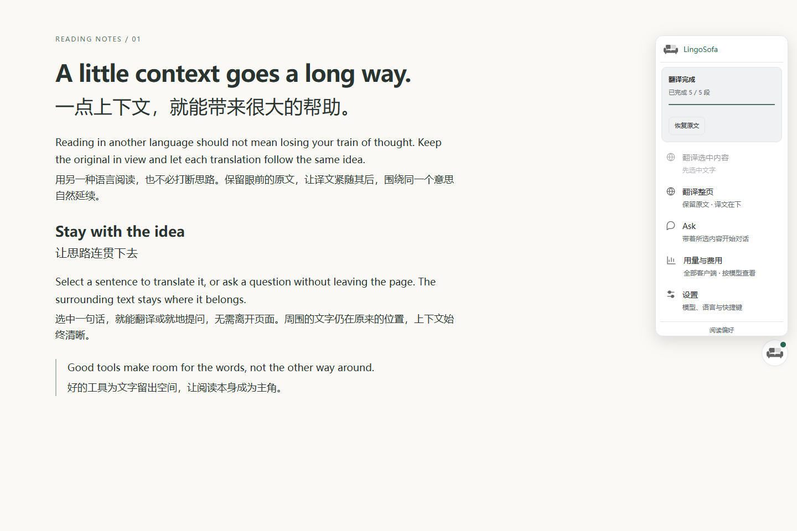
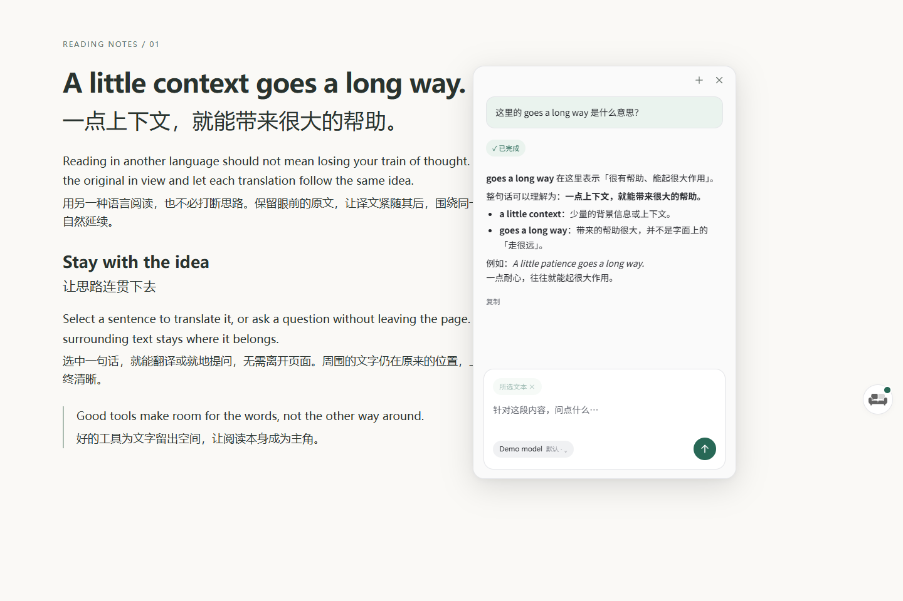
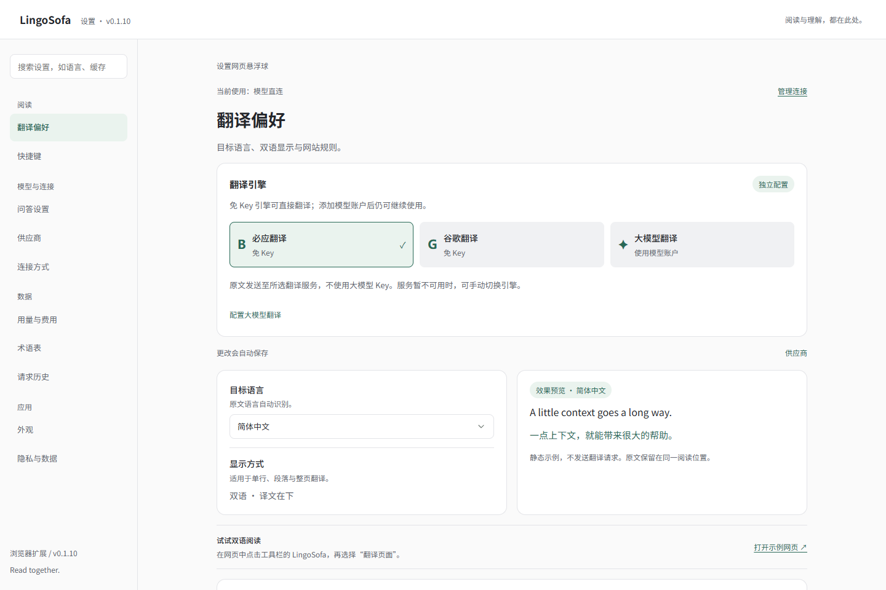

<p align="center">
  
</p>

<h1 align="center">LingoSofa</h1>

<p align="center">双语阅读，就地提问。</p>

<p align="center">
  <a href="README.md">English</a> · <a href="README-zh.md">简体中文</a>
</p>

<p align="center">
  <a href="https://github.com/ChenMiaoi/lingo-sofa/actions/workflows/ci.yml"></a>
  <a href="https://github.com/ChenMiaoi/lingo-sofa/releases/latest"></a>
  <a href="LICENSE"></a>
</p>

LingoSofa 为网页和 Discord 提供原位双语翻译与上下文问答。保留原文，在旁边阅读译文，直接围绕选中的内容提问。两个客户端可以共用电脑上的一个本地助手和同一组模型账户。

[效果预览](#效果预览) · [开始使用](#开始使用) · [下载版本](https://github.com/ChenMiaoi/lingo-sofa/releases) · [文档](#文档) · [反馈问题](https://github.com/ChenMiaoi/lingo-sofa/issues)

> **开发预览版。** 已在 macOS 和 Windows 上完成浏览器扩展与 Discord 集成验证。Release CI 面向五种系统/芯片组合构建，但不代表每个平台都已完成客户端验收。当前安装包尚未签名，具体状态见 [兼容性清单](docs/compatibility.md) 和 [发布准备](docs/release-readiness.md)。

## 效果预览

**双语阅读，保留原文。** 译文紧随原文，阅读控制随手可用。

<p align="center">
  
</p>

<details>
<summary>展开查看 Ask 问答与翻译设置</summary>

**就地提问，读懂上下文。** 选中一句话，在文章旁边的对话中询问它的含义。

<p align="center">
  
</p>

**按需选择翻译方式。** 切换免 Key 或大模型翻译，选择目标语言，预览双语排版。

<p align="center">
  
</p>

</details>

截图来自当前浏览器扩展，文章为演示内容，译文和回答由本地模拟服务提供。

## 功能

- **原位双语翻译**：翻译段落、选中文字或 Discord 消息，保留原文；按网站或频道单独开启自动双语阅读。
- **围绕内容提问**：在选中内容旁打开对话，用来解释、总结或起草回复。回复由你审阅和复制，不会自动发送。
- **自由选择模型**：供应商账户统一保存在本地助手，浏览器与 Discord 共用。翻译与问答分别选择默认模型，内容上下文保持隔离。
- **免 Key 翻译**：浏览器和 Discord 均可选择必应或谷歌翻译；没有模型凭证时默认使用必应。配置模型账户后仍可保留免费引擎，翻译引擎与 Ask 模型独立设置。详见 [翻译引擎](docs/translation-engines.md)。
- **共用本地助手**：浏览器和 Discord 复用同一份安装与模型配置，内容上下文保持隔离。
- **查看实际观测用量**：查看 Tokens、请求记录和估算费用；未知用量不会当成零，中断请求不会自动重发。

## 开始使用

前往 [Releases](https://github.com/ChenMiaoi/lingo-sofa/releases) 获取构建产物。如果暂时没有可下载版本，可以先 [从源码构建](#开发)。

| 组件         | 下载文件                                                  | 安装方式                                                  |
| ------------ | --------------------------------------------------------- | --------------------------------------------------------- |
| 浏览器扩展   | `lingo-sofa-browser-<version>.zip`                        | 开启 Chrome 或 Edge 开发者模式，将 ZIP 拖入扩展页面安装。 |
| Discord 插件 | `lingo-sofa-vencord-<version>.tar.gz`                     | 集成到自定义 Vencord 构建；不是独立 Discord 安装器。      |
| 本地助手     | `lingo-sofa-assistant-<version>-<platform>-<arch>.tar.gz` | 选择对应系统和芯片，解压并运行内附安装入口；已自带 Node。 |

助手构建覆盖 macOS Apple Silicon / Intel、Linux ARM64 / x64 和 Windows x64。完整安装、浏览器授权和升级步骤见 [安装说明](docs/installation.md)。

### 浏览器

1. 打开 `chrome://extensions` 或 `edge://extensions`，开启 **开发者模式**，将浏览器 ZIP 直接拖入页面安装，无需解压。若浏览器不接受 ZIP，再解压并选择 **加载已解压的扩展程序**。
2. 打开 LingoSofa 设置。必应和谷歌无需助手；大模型翻译与 Ask 统一使用共享本地助手，两端读取同一份账户。扩展和助手应同时更新，再从连接页面迁移旧浏览器账户。新版助手自动授权固定扩展 ID。旧扩展 ID 首次迁移前，请查看[浏览器更新与配置保留说明](docs/installation.md#配置保存与浏览器更新)。
3. 在 **翻译偏好** 选择必应或谷歌即可免 Key 翻译；需要大模型翻译或 Ask 时，再添加供应商账户并分别配置。
4. 打开网页，从扩展弹出菜单显示阅读悬浮球。悬停段落可翻译，选中文字可使用 **翻译 / Ask**；也可按 **Alt+Shift+A** 围绕所选内容提问。

自动翻译需要按网站单独开启。点击 **恢复原文** 可移除原位译文。

### Discord

桌面端当前依赖 [Vencord](https://vencord.dev/)，提供消息翻译、频道自动阅读和上下文问答。自定义插件需要加入自定义 Vencord 构建，直接安装标准 Vencord 并不会包含 LingoSofa。

接入 Windows 安装流程的新 Release 提供 `LingoSofa-Setup-<version>-win32-x64.exe`，可一起安装预编译 Vencord、LingoSofa 和本地助手，无需自己编译或安装 Node。插件设置提供检查、下载和安装新版本入口；安装前退出连接的客户端，安装后启动 Discord 生效。详见 [Windows 安装与更新](docs/installation.md#windows-x64一体化安装与更新)。

启用插件后，会复用已有本地助手；构建中包含发行清单时，缺少助手会自动下载、校验并安装对应版本。浏览器仍需单独授权扩展 ID。辅助构建和安装流程见 [Discord 安装说明](docs/installation.md#vencord-是否能省掉)。

## 隐私与数据

LingoSofa 不要求部署专门的云端后台。本地助手仅监听 `127.0.0.1`，同一电脑、同一系统用户下的客户端可以共用。助手按需启动，所有客户端断开且在途任务结束后延迟退出。

翻译或提问的内容会发送给你选择的模型供应商。自动阅读需要按网站或频道授权；即使共用模型凭证，浏览器与 Discord 的内容上下文仍保持隔离。跨端共享用量统计默认关闭。

费用只反映 LingoSofa 观测到的请求，不代表整个供应商账户的账单。订阅模式展示的 API 等值费用是估算值，不是订阅实扣。详见 [隐私说明](docs/privacy.md) 和 [认证与计价](docs/oauth.md)。

## 开发

使用 **Node.js 24** 和 npm。打包时应使用官方 Node 发行版，以便助手携带完整运行环境。

```sh
git clone https://github.com/ChenMiaoi/lingo-sofa.git
cd lingo-sofa
npm ci
npm run check
```

构建后，从 `apps/browser-extension/.output/chrome-mv3` 加载浏览器扩展；开发时可运行 `npm run dev`。

| 命令                              | 用途                                                            |
| --------------------------------- | --------------------------------------------------------------- |
| `npm run check`                   | 检查 lint、格式、类型、测试、应用构建和 MV3 产物。              |
| `npx playwright install chromium` | 安装 E2E 测试所需浏览器。                                       |
| `npm run test:e2e`                | 运行浏览器集成测试。                                            |
| `npm run verify:vencord`          | 与固定版本 Vencord 进行类型和构建验证，不修改已安装的 Discord。 |
| `npm run setup:discord`           | 准备包含 LingoSofa 的自定义 Vencord 构建。                      |
| `npm run package:distribution`    | 为当前系统和芯片生成本地分发候选包。                            |

如果需要把自定义 Vencord 安装到 Discord，请先关闭 Discord，再明确执行 `npm run setup:discord -- --install`，通过上游安装器选择要修改的客户端。

推送 `v0.1.0` 这类版本 tag 会触发自动构建和 GitHub Release 发布。版本校验、平台构建及下载校验值规则见 [Release CI](docs/release-ci.md)。

### 仓库结构

```text
apps/
  browser-extension/   Chrome / Edge 扩展
  discord-vencord/     Discord 集成
  pi-bridge/           共享本地助手与安装器
packages/              翻译核心、协议与共享组件
docs/                  设计、安装说明与验证记录
```

## 文档

| 文档                                      | 内容                              |
| ----------------------------------------- | --------------------------------- |
| [安装说明](docs/installation.md)          | 安装、授权、升级与 Vencord 集成。 |
| [兼容性清单](docs/compatibility.md)       | 已支持的场景与当前限制。          |
| [隐私说明](docs/privacy.md)               | 内容边界、凭证与数据保留。        |
| [架构与协议](docs/architecture.md)        | 共享核心、通信协议与会话隔离。    |
| [服务生命周期](docs/service-lifecycle.md) | 启动、共享连接与退出规则。        |
| [Release CI](docs/release-ci.md)          | 按 tag 构建与发布。               |
| [验证记录](docs/acceptance.md)            | 已完成的检查与剩余验收。          |

## 参与贡献

欢迎提交问题、可复现示例和聚焦的改进。较大的变更请先通过 [Issue](https://github.com/ChenMiaoi/lingo-sofa/issues) 讨论，提交 PR 前阅读 [贡献规范](AGENTS.md)，附上相关检查结果；请勿在报告中包含凭证或私人内容。

LingoSofa 基于 [Pi](https://github.com/earendil-works/pi)、[WXT](https://github.com/wxt-dev/wxt) 和 [Vencord](https://github.com/Vendicated/Vencord) 构建。依赖许可见 [第三方声明](THIRD_PARTY_NOTICES.md)。

## 许可证

LingoSofa 采用 **GNU GPL 第 3 版或更新版本**（[GPL-3.0-or-later](LICENSE)）。Copyright © 2026 LingoSofa contributors。

第三方组件保留各自许可证。LingoSofa 插件归档不包含 Vencord 或 Discord 二进制；再分发时仍需遵守适用的许可、版权声明与源码交付要求。
